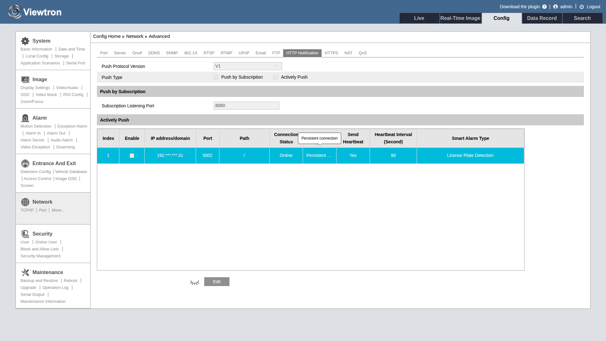
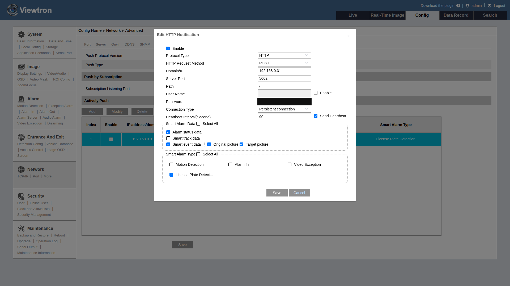

# Enable HTTP POST on Cameras and NVRs

Before your server can receive AI detection events, you need to enable HTTP POST on the device that will send them. This page walks through the web interface setup for both IP cameras and NVRs.

:::tip Which device should send events?
- **IP Camera (direct)** - camera sends HTTP POST directly to your server. Requires the camera to be on your local network via a PoE switch (not through NVR PoE ports).
- **NVR (forwarded)** - NVR receives events from connected cameras and forwards them to your server. Use this when cameras are connected to the NVR's built-in PoE ports, or when you want a single endpoint for all cameras.
- **Both** - for maximum flexibility, configure the NVR to forward alarm events with images, and configure individual cameras to send `traject` real-time tracking data directly. Your server receives both streams.
:::

---

## IP Camera Setup

### Step 1: Access the Camera Web Interface

Open a web browser and navigate to your camera's IP address. Log in with administrator credentials.

### Step 2: Navigate to HTTP Notification Settings

Go to **Config > Network > HTTP Notification** tab. The camera firmware calls this page **HTTP Notification**, not HTTP POST. In the left menu the tab is reached from **Network > More...**, and the breadcrumb reads **Config Home > Network > Advanced**.

On LPR-IP4 firmware 5.3.1 the path is **Config > Network > More... > HTTP Notification** tab, and the page heading reads **Network Advanced**.

At the top of the HTTP Notification page (LPR-IP4 firmware 5.3.1) are three settings:

| Setting | Description |
|---------|-------------|
| **Push Protocol Version** | `V1` or `V2`. Selects the HTTP POST protocol version the camera uses |
| **Push Type** | Two checkboxes that can both be on. **Actively Push** makes the camera connect out to the servers in the table and POST events to them, which is what you need for your own server. Unchecking it hides the server table and stops the posts. **Push by Subscription** works the other way: a third-party platform connects in to the camera on the Subscription Listening Port and subscribes to events. |
| **Subscription Listening Port** | The port the camera listens on for Push by Subscription platforms. The default is 8080 (range 1-65535). Actively Push does not use it. |

### Step 3: Edit the Configuration

The configured server destinations are listed in a table under **Actively Push** on the HTTP Notification page. Click the **Edit** button below the table to unlock the page for changes.

Each row in the table shows:

| Column | Meaning |
|--------|---------|
| **Index** | Row number of the server entry |
| **Enable** | Whether this entry is active |
| **IP address/domain**, **Port**, **Path** | Where the camera sends events |
| **Connection Status** | **Online** or **Offline**: whether the camera can reach your server. **Offline** means the server is unreachable or is not acknowledging posts (see [Server Requirements](#server-requirements)) |
| **Connection Type** | Persistent or Non-Persistent connection (LPR-IP4 firmware 5.3.1) |
| **Send heartbeat** | Whether keepalive posts are on |
| **Heartbeat Interval(Second)** | Seconds between keepalives |
| **Smart Alarm Type** | Detection types this entry sends |

The camera supports up to **3 server entries**. Each entry has its own data and alarm type selections, so you can send different events to different servers.

The eye icon next to the **Edit** button shows or hides sensitive data in the table, such as the server address.



After you click **Edit**, the **Add**, **Modify**, **Delete**, and **Test** buttons appear above the table, plus a **Save** button for the page. **Add** opens the **Add HTTP Notification** dialog for a new entry. **Modify** opens **Edit HTTP Notification**, the same form, for the selected entry. **Delete** removes the selected entry. **Test** sends an empty POST to the selected server's path. If the server answers HTTP 200, the camera shows Test successful. This is not the regular heartbeat, which is a separate keepalive message sent every Heartbeat Interval. Click **Add** to create a new server entry, or select an entry and click **Modify** to open the **Edit HTTP Notification** dialog. Fill in your API server details. The same dialog also holds the Smart Alarm Data (Step 4) and Smart Alarm Type (Step 5) selections:



Configure the following settings:

| Setting | Description | Example |
|---------|-------------|---------|
| **Enable** | Check to activate this HTTP Notification entry | Checked |
| **Protocol Type** | `http` or `https`. LPR-IP4 firmware 5.3.1 offers `HTTP` only | `http` |
| **HTTP Request Method** | `POST` or `GET` (LPR-IP4 firmware 5.3.1) | `POST` |
| **Domain/IP** | IP address of your API server | `192.168.0.53` |
| **Server Port** | Port your server listens on (1-65535) | `5002` |
| **Path** | URL path for the webhook endpoint | `/API` |
| **User Name / Password** | Optional authentication for your server. Check the **Enable** box to the right of User Name to turn it on | Leave unchecked unless your server requires it |
| **Heartbeat Interval** | Seconds between keepalive messages. Range is 30-120 seconds per the API reference (the web interface shows no range) | `90` |
| **Send heartbeat** | Check to receive periodic keepalive POSTs | Checked |
| **Connection Type** | `Persistent Connection` or `Non-Persistent Connection` (LPR-IP4 firmware 5.3.1) | `Persistent Connection` |

Heartbeats (keepalives) are small periodic POSTs, often with an empty body, that confirm the connection is up while no events occur. Your server must acknowledge each one (see [Server Requirements](#server-requirements)).

The **Push Protocol Version** (V1/V2) selector is at the top of the page, not in this dialog (see Step 2).

### Step 4: Select Smart Alarm Data

In the **Smart Alarm Data** section of the **Edit HTTP Notification** dialog (screenshot in Step 3), choose what data to include with each event. **Select All** checks every option in this group.

| Option | What It Sends | When to Use |
|--------|--------------|-------------|
| **Alarm status data** | Alarm on/off state changes (~660 bytes) | When you need to know when detection starts and stops |
| **Smart track data** | Continuous real-time target tracking (~1.7 KB at ~7/sec) | When you need live bounding box coordinates for tracking targets across the frame |
| **Smart event data** | Detection event with coordinates (~2-3 KB) | When you need detection events with classification data |
| **Original picture** | Full-frame JPEG snapshot, base64 encoded (~500-530 KB) | When you want an overview image of the scene |
| **Target picture** | Cropped target JPEG, base64 encoded (included in the event post) | When you want a close-up of the detected person, vehicle, or plate |

**Original picture** and **Target picture** are sub-options of **Smart event data**. The images are embedded in the same event post, not sent as separate posts. Each one can be turned off on its own. For example, an LPR camera can send plate events with no images.

:::tip
For most applications, enable **Smart event data** + **Original picture** + **Target picture** to receive complete detection events with images. Add **Smart track data** if you need continuous real-time object tracking (e.g., for PTZ auto-follow or trajectory analysis).
:::

### Step 5: Select Smart Alarm Types

In the **Smart Alarm Type** section of the same dialog, check which AI detection types should trigger events. **Select All** checks every type.

| Alarm Type | Detection |
|------------|-----------|
| **Region Intrusion** | Person or vehicle enters a defined zone |
| **Line Crossing** | Person or vehicle crosses a virtual tripwire |
| **Region Entrance** | Target enters a zone |
| **Region Exiting** | Target exits a zone |
| **Target Counting by Line** | Count targets crossing a line |
| **Target Counting by Area** | Count targets in a zone |
| **Motion Detection** | Any motion (not AI-filtered) |
| **Video Metadata** | Full-frame object detection data |
| **Loitering Detection** | Person stays in a zone too long |
| **Illegal Parking Detection** | Vehicle parked in a restricted zone |
| **Alarm In** | Physical alarm input (sensor) on the camera |
| **Video Exception** | Abnormal video detection (AVD in the API reference; LPR-IP4 firmware 5.3.1) |
| **License Plate Detection** | License plate read (LPR cameras) |

The alarm type list depends on the camera model and firmware. Only the types your camera supports are shown. For example, LPR-IP4 firmware 5.3.1 offers Motion Detection, Alarm In, Video Exception, and License Plate Detection. The screenshot in Step 3 shows all four (License Plate Detection is truncated to "License Plate Detect...").

:::note
AI detection rules (intrusion zones, tripwires, etc.) must be configured separately in the camera's **Event** settings before the camera will generate these alarm types. Enabling them here only controls whether events are forwarded via HTTP POST.
:::

### Step 6: Save

Click **Save** in the dialog, then **Save** on the page, to apply the configuration. The camera will begin sending HTTP POST events to your server immediately when detections occur. No reboot is needed.

:::note LPR-IP4 firmware 5.3.1
On LPR-IP4 firmware 5.3.1, saving an entry here also turns on the older V1 HTTP POST sender, aimed at the same host, port, and path. There is no separate V1 switch on the page. In testing, posts arrived in the V1 layout.
:::

---

## NVR Setup

HTTP POST on a Viewtron NVR needs NVR firmware that supports it. Step-by-step NVR screens for that firmware are coming soon.

:::caution Alarm Server is not HTTP POST
Some NVR firmware has a page called **Alarm Server** under **Event Notification**. That is a separate feature, not HTTP POST, so it is not covered in this guide.
:::

---

## Server Requirements

The camera or NVR stops sending if your server does not answer correctly. Any server that receives these posts must:

1. **Acknowledge every POST immediately.** This includes empty-body keepalives. Return HTTP 200 with an XML success body *before* parsing the post. If the device does not get this response, it treats the server as unreachable (Connection Status shows **Offline**) and stops sending.
2. **Support HTTP/1.1 persistent connections.** Cameras send `Connection: keep-alive` and hold the TCP connection open. Set your server's keepalive timeout to **60 seconds or more**. For example, the Node.js default of 5 seconds drops the connection between heartbeats.
3. **Handle requests concurrently.** Parsing one camera's large image post must not delay another camera's keepalive acknowledgment.
4. **Treat empty POSTs as keepalives.** Acknowledge them and skip parsing.

The Python server below already does all of this.

---

## Verify Events Are Arriving

The quickest way to verify your setup is to run the Python alarm server from the [GitHub repository](https://github.com/mikehaldas/IP-Camera-API):

```bash
git clone https://github.com/mikehaldas/IP-Camera-API.git
cd IP-Camera-API
python3 -m venv venv
source venv/bin/activate
pip install -r requirements.txt
pip install viewtron
python3 server.py
```

Then trigger a detection event (walk in front of a camera with an intrusion zone configured). You should see event data printed to the console within seconds.

## Troubleshooting

| Problem | Check |
|---------|-------|
| No events received | Is your server listening on the correct port? Can the camera/NVR reach your server's IP? |
| Events arrive but no images | Check image/picture options in the HTTP POST configuration |
| Intermittent events | Check the heartbeat interval - if your server doesn't respond to keepalives, the connection drops |
| Events stop after a few posts, Connection Status shows Offline | Your server is not acknowledging every POST and keepalive with HTTP 200 + XML success, or its keepalive timeout is too short. See [Server Requirements](#server-requirements) |
| Events from camera but not NVR (or vice versa) | Camera direct and NVR forwarded are independent configurations - set up both if you want both |
| AI alarm types not firing | AI detection rules (intrusion zones, tripwires) must be enabled in the camera's Event settings separately |

## Next Steps

- **[Webhook Event Notification API](/docs/applications/webhook-event-notification-api)** - XML format reference, detection types, and code examples for processing events
- **[Authentication](/docs/getting-started/authentication)** - how API request authentication works
- **[Supported Products](/docs/supported-products)** - which cameras and NVRs support HTTP POST
